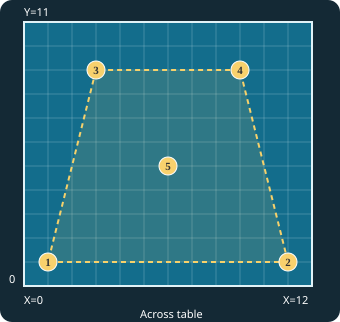
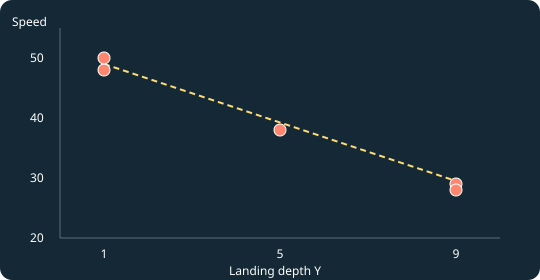

# OpenPong · Dora Drill Control

A browser-based Web Bluetooth drill controller for the **Pusun Dora Smart Pro TT** table-tennis robot.

This standalone fork keeps a **modular robot adapter API** so contributors can add support for other robots later. It does not ship Nova BLE commands, RPM conversions, or Nova-specific training logic.

**Launch OpenPong:** [https://roechamboe.github.io/OpenPong/](https://roechamboe.github.io/OpenPong/)

## Running

- Serve this directory over HTTPS (GitHub Pages works), or locally from `localhost` with a static HTTP server.
- Open it in a Chromium-based browser with Web Bluetooth support and select **Connect**.
- Choose a drill, difficulty 1–3, and either a ball count or duration.
- Tap a drill to start; long-press or tap the ≡ grip to edit; drag the grip to reorder.
- To stop early, disconnect from the UI or use the robot's physical stop button.

**Hardware safety:** Session stopping is sent over BLE. Always keep the robot's physical stop accessible, especially while testing unfamiliar shot parameters.

## Fundamental shot baseline (factory v8)

The factory drills use **six fundamental Dora-native shots**. Four are now based on your physically tuned settings; **Drive remains unchanged from v7** because it was reported to land comfortably on the table and feel appropriate, though somewhat challenging for Level 1.

The vector order is exactly **Dir:Speed:Spin:Freq:Arc:SpinType**. Frequency and Arc must not be swapped.

| Shot | Level 1 parameter vector | Status |
| --- | --- | --- |
| Forehand Push | `11:28:10:15:35:180` | Hardware-tuned baseline |
| Backhand Push | `71:28:10:15:35:180` | Hardware-tuned baseline |
| Forehand Drive | Existing v7 settings, unchanged | Provisional; physically acceptable |
| Backhand Drive | Existing v7 settings, unchanged | Provisional; physically acceptable |
| Forehand Loop | `5:40:20:40:35:0` | Hardware-tuned baseline |
| Backhand Loop | `76:40:20:40:35:0` | Hardware-tuned baseline |

Push spin angle 180 represents the tested backspin configuration; Loop spin angle 0 represents topspin. Direction is calibrated separately for forehand/backhand. These exact four parameter vectors are **not generated from the no-spin placement estimator**; the original five-point no-spin model remains available for independent placement work.

The **Basic Level 1** Push and Loop vectors are reproduced exactly. Because only one tuned vector per stroke was supplied, **Basic Levels 2 and 3 are provisional progressions**: respectively +3/+6 Speed, +3/+6 Spin, and +10/+20 Frequency relative to Level 1, with Direction, Arc, and SpinType unchanged. Drives keep all their previous v7 difficulty settings. Combined and Complex factory drills use the Level 1 versions of their constituent shots at all difficulty settings, as before.

Factory preset **version 8** updates recognized *untouched* stored legacy factory levels while preserving user-edited levels and custom drills. This update does **not** purge historical migration code or older saved records; cleanup can happen after the complete baseline is validated and backed up. Calibration Engine measurements remain separate from the factory drill library and are not automatically applied to drills.

**Frequency 15:** Earlier OpenPong versions imposed a minimum of 20. v8 accepts 15 through the editor, clipboard parser, drill validation, and Dora protocol encoder to preserve your exact tested Push values. The interval formula supports this value, but **wire-level verification with the live robot through OpenPong remains outstanding**. Do not assume changing only the UI limit establishes full hardware compatibility.

### Validation status

Your tests found that the earlier Push had appropriate backspin but excessive pace; Drive was faster/flatter, Loop had more arc, less pace, stronger topspin, and both Drive and Loop landed comfortably. The four updated Push/Loop vectors are your selected tuned baselines. Live testing of their saved factory sequences and their Level 2/3 progressions is still needed. Keep the robot's physical stop accessible when verifying settings.

## Dora functions

- Native 15-byte BLE messages over service FFF0, with notifications on FFF1 and writes on FFF2.
- 34 Nova-inspired factory *patterns* mapped to Dora-native direction, speed, spin, arc, frequency, and spin angle. These are approximate starting values, **not hardware-calibrated shot equivalences**.
- Basic, Combined, Complex and Custom A/B/C libraries.
- Three difficulty levels, ball variants, shuffle, scatter and reorder.
- Reps (launch notifications) and Time limits; saved cumulative ball/drill counters.
- Native Dora volume and brightness controls.
- JSON drill import/export; data saved in browser local storage.

**Not yet validated:** All drill presets, multi-ball operation, and volume/brightness commands require further physical testing. Pause/resume is not supported.

## Calibration Engine — setup and workflow

The **Calibration Engine** converts physical ball-placement measurements into a reusable placement model. It is accessible through the top-right **☰ → Calibration Engine**, immediately above **Ball Placement Estimator**. Both screens use the same receiver-perspective table map.

### 1. Set up the table and robot

- Use **No Spin**, **Difficulty Level 1**, and consistent launch conditions while collecting measurements.
- From the **receiver's viewpoint**, the grid origin **(0,0)** is the *leftmost corner of the receiver's end line*. X increases left-to-right from 0 to 12 and Y increases toward the net from 0 to 11. These are grid-line coordinates: 12 horizontal intervals and 11 depth intervals, with 13 × 12 possible intersections.
- Place the Dora robot on the table center line at the **opponent's end line**: X=6, Y=22 in a full-table coordinate system where the receiver's end line is Y=0 and the net is Y=11. Keep robot alignment, height and placement unchanged throughout calibration. This location is **fixed profile metadata**, not a physical aiming correction: moving the robot requires re-measurement.
- Mark each target intersection with a small Post-it note, then adjust **Direction, Speed and Arc** on the robot until repeated launches reach the target. Record the settings and, ideally, hits out of ten and landing scatter externally; the current editor stores only coordinates and three settings, not hit counts.



### 2. Select, add, and edit points using the map

1. Open **☰ → Calibration Engine**. The map shows **numbered gold circles** for calibration targets and a **red highlight** for the selected point. A lightly shaded/dashed boundary represents the extent of the measured positions (convex hull).
2. **Tap a numbered circle** to select a saved or currently edited target. Its X, Y, Direction, Speed and Arc fields appear beneath the map.
3. To add a position, **tap an empty grid intersection** or choose **+ Add target**. The new point becomes selected. The Add button proposes an unused position, prioritizing (3,5), (9,5), (6,3), and (6,7).
4. **Replace the provisional parameter values with physically measured settings.** A newly tapped point initially inherits a nearby point's settings; the Add button initially uses Direction 42, Speed 38 and Arc 15. Both are placeholders, **not calibration results**.
5. Edit the selected fields. Changes are staged locally and the page displays **Unsaved changes**. You can select another marker without losing those staged edits.
6. Choose **Save calibration** to validate and persist all points and immediately refresh the placement estimator. **Delete selected point** removes a point from the draft; **Reset five points** restores the original measurements in the draft, and must also be saved to apply. Closing and reopening without saving discards staged changes.

The editor accepts unique integer X (0–12), Y (0–11), Direction (0–90), Speed (20–100) and Arc (-65–65), between **3 and 100 calibration targets**. At least three must be non-collinear for interpolated predictions. Invalid coordinates or duplicate positions are rejected on editing/saving. Calibration storage is browser-local under `openpong_placement_calibration_v1`; it is **separate from drill storage**, and the standard Export Drills function does not export it. Back up calibration values independently before changing browsers or clearing site data.

### 3. Expand from five to nine measured targets

The original five target measurements are preserved as the initial profile:

| Target | X | Y | Direction | Speed | Arc |
| ---: | ---: | ---: | ---: | ---: | ---: |
| 1 | 1 | 1 | 80 | 48 | 15 |
| 2 | 11 | 1 | 0 | 50 | 15 |
| 3 | 3 | 9 | 81 | 29 | 20 |
| 4 | 9 | 9 | 0 | 28 | 40 |
| 5 | 6 | 5 | 42 | 38 | 15 |

For a nine-point session, suggested additional targets are **(3,5), (9,5), (6,3), and (6,7)**. For each one: position the Post-it, find repeatable settings on the physical robot, add/select that grid location in the Calibration Engine, enter the actual Direction/Speed/Arc values, and save. Do not leave provisional defaults in the profile as if they were observations.

### 4. Estimate and transfer a ball into a drill

1. Open **☰ → Ball Placement Estimator**. The map uses the **saved** calibration profile, including any additional targets. Adjust the integer X and Y sliders.
2. At a measured point, the estimator returns its exact recorded settings. Between points, it calculates a prediction **only inside the measured convex hull**; outside it, it shows no values. Arc is selected from the nearest recorded point and remains experimental.
3. Choose **Copy proposed settings** to copy a six-part colon-separated vector:
   ```text
   Dir:Speed:Spin:Freq:Arc:SpinType
   40:39:0:35:15:180
   ```
   The numeric line is illustrative. Direction/Speed are rounded to integers; Spin=0, Freq=35, SpinType/angle=180 are provisional defaults, not additional placement calibrations.
4. Open the desired drill's ball editor and choose **Paste parameters** on the specific ball variant. The clipboard vector is validated and applied to that variant only; malformed vectors do not change its parameters. Press the drill editor's **Save** button to persist the changes. Neither the Calibration Engine nor the Placement Estimator automatically sends robot commands.
5. Verify predicted shots on the physical table before using them in training. Keep the robot's physical stop accessible.

### 5. How the data-driven model works

`js/calibration-engine.js` exports `DEFAULT_PROFILE`, `validateProfile`, `loadCalibration`, `saveCalibration`, and `estimatePlacement(x,y,profile)`. `js/placement-map.js` draws the shared grid, selected marker, numbered measurement points and convex-hull overlay. `js/calibration-ui.js` manages the editable draft and save workflow; `js/placement-estimator.js` reads saved measurements and produces clipboard vectors.

The engine uses locally selected triangles meeting an **empty-circumcircle (Delaunay) criterion**. For a target P inside a containing triangle with vertices P₁, P₂, P₃, barycentric weights sum to one:

```text
P = w1 * P1 + w2 * P2 + w3 * P3
w1 + w2 + w3 = 1
Direction(P) = w1 * Direction1 + w2 * Direction2 + w3 * Direction3
Speed(P) = w1 * Speed1 + w2 * Speed2 + w3 * Speed3
Arc(P) = Arc of nearest measured calibration point
```

Exact recorded positions reproduce their measured values; the model does not extrapolate outside the convex hull. The triangle/arc approximations are **experimental** and can be refined as more physical evidence is collected; extra points do not guarantee improved landing accuracy without validation. The robot's stored (6,22) position is a calibration-condition assumption rather than a variable in the interpolation equations.

### Practical cautions and troubleshooting

- **No prediction appears:** the target may be outside the measured convex hull, or the profile may lack a usable triangle. Add real measurements around that area rather than extrapolating.
- **New targets give implausible predictions:** confirm all newly added rows contain *measured*, not placeholder, settings. Check X/Y orientation and unchanged robot placement.
- **Clipboard paste fails:** use HTTPS or localhost with a browser supporting clipboard reads/writes, check the six colon-separated integers and their permitted parameter ranges, and use the ball variant's **Paste parameters** control.
- **Measurements vanish in another browser/device:** calibration uses local storage and does not sync. Record or back it up separately.
- **Saved drill does not change:** saving calibration updates the estimator, **not existing drills**. Copy from the estimator, paste into the desired ball variant, then Save the drill.

## Experimental ball placement estimator

From the top-right menu, choose **Ball Placement Estimator** (between **Calibration Engine** and **Device Settings**). This is a reference calculator: it **does not send BLE commands, update drills or apply settings**. Its assumptions are **No Spin** and **Difficulty Level 1**.

### Measured calibration procedure

We divided the receiver's table half into **12 equal intervals across (grid lines X = 0–12)** and **11 intervals along its length (grid lines Y = 0–11)**. There are 13 × 12 grid intersections, not 12 × 11 points. The origin **(0,0) is the receiver's leftmost corner at their end line, from the receiver's own viewpoint**. X increases left-to-right across the receiver's table half; Y increases from the receiver's end line toward the net. No right-handedness or forehand/backhand convention is implied. We placed a Post-it note at each target and adjusted the robot's Direction, Speed and Arc until multiple shots out of ten hit each note. Actual hit counts were not recorded.


| Target | (X, Y) | Direction | Speed | Arc |
| ---: | --- | ---: | ---: | ---: |
| 1 | (1,1) | 80 | 48 | 15 |
| 2 | (11,1) | 0 | 50 | 15 |
| 3 | (3,9) | 81 | 29 | 20 |
| 4 | (9,9) | 0 | 28 | 40 |
| 5 | (6,5) | 42 | 38 | 15 |



### Historical first-pass estimator (v0.1, superseded by triangulation)

At depth Y = 1, the two measured direction settings imply **D = 88 − 8X**. At depth Y = 9, they imply **D = 121.5 − 13.5X**. Linear interpolation between these *two calibrated endpoints at each depth* uses:

```text
t = (Y - 1)/8
leftX = 1 + 2t
rightX = 11 - 2t
leftDirection = 80 + t
Direction(X,Y) = leftDirection * (rightX - X)/(rightX - leftX)
```

At (6,5), direction interpolates to **40.25**, compared with measured **42** (difference 1.75). This is a sanity check, not an independent validation.

A least-squares fit of all five speed observations to depth gives:

```text
Speed(Y) = 51.5625 - 2.5625*Y
```

It predicts speed 49 at Y=1, 38.75 at Y=5, and 28.5 at Y=9; the observed speed pairs at Y=1 and Y=9 were 48/50 and 29/28 respectively. Direction, speed and arc can interact; this correlation does **not** prove speed independently sets depth.

**Arc is not modeled continuously:** the UI selects the arc value from the geographically closest of the five calibrated points, measured in squared grid-distance. In particular, at Y=9 the observed arcs differ substantially (20 at X=3 versus 40 at X=9). Using nearest-neighbor arc is only a provisional starting strategy.

The historical v0.1 UI predicted only within the quadrilateral connecting (1,1), (11,1), (9,9), (3,9):

```text
1 <= Y <= 9,  leftX <= X <= rightX
```

Outside this region it displays no prediction, rather than extrapolating. Slider steps are integers to match the Post-it coordinate system. Values are *experimental estimates* until physically checked.

### Validation and safety

Next, compare predicted and observed landings at additional positions (e.g. (3,5), (9,5), (6,7)), recording hit counts out of ten and actual landing coordinates; use those measurements to improve the two-dimensional direction model and arc handling. Keep the robot height, position and orientation fixed between tests. Use the robot's physical stop while testing unfamiliar parameters.

### Ball parameter clipboard format

The estimator's **Copy proposed settings** exports the six-field, colon-delimited Dora vector:

```text
Dir:Speed:Spin:Freq:Arc:SpinType
40:39:0:35:15:180
```

The estimator rounds predicted Direction and Speed to integers, sets **Spin = 0** (no spin), **Freq = 35** (provisional firing frequency), and **SpinType = 180** (Dora editor's native spin-angle field, not a separate spin mode). Those latter defaults have *not* been established by these placement measurements. In the drill editor, each ball variant has a **Paste parameters** control that reads the clipboard, validates all six values, and updates only that ball variant. Valid values are integer Direction 0–90, Speed 20–100, Spin 0–60, Freq 15–170, Arc -65–65, and SpinType/angle 0–359. Invalid vectors leave the ball unchanged. Save the drill to persist an imported vector. Clipboard access requires a supported browser and secure origin (HTTPS/localhost).

The X-axis is drawn increasing **left-to-right** from the receiver's viewpoint; **(0,0) is their leftmost end-line corner**. This correction changes display orientation, not the original calibration coordinates or fitted equations.

## Extending the robot abstraction

`js/core/robot-manager.js` exports:

- `registerAdapter(id, adapter)`
- `getRobotIds()`, `getActiveRobotId()`, `getActiveAdapter()`
- `selectRobot(id)`, `onRobotEvent(listener)`

Every adapter must export `bleState`, `connectDevice`, `disconnectDevice`, `sendPacket`, and `setEventHandler`. Adapters emit structured events such as `ready`, `disconnected`, and `ballLaunched`.

The Dora adapter lives in `js/robots/dora/`. Future implementations can add a separate adapter and their own drill-model translator without coupling the UI to a second protocol. The standalone UI currently exposes Dora-native fields; abstracting editor parameter schemas for additional robots is future work.

## Data migration

Existing Dora drill storage (`openpong_dora_drills_v1`) remains unchanged. Aggregate statistics migrate from the legacy `nova_stats` key to `openpong_stats` when first saved. Theme preferences also accept the legacy key.

## Acknowledgements

Forked from [olanga/nova](https://github.com/olanga/nova), whose visual styling and drill patterns inspired the original OpenPong interface. Dora support and BLE serialization are independent of the Nova protocol.
